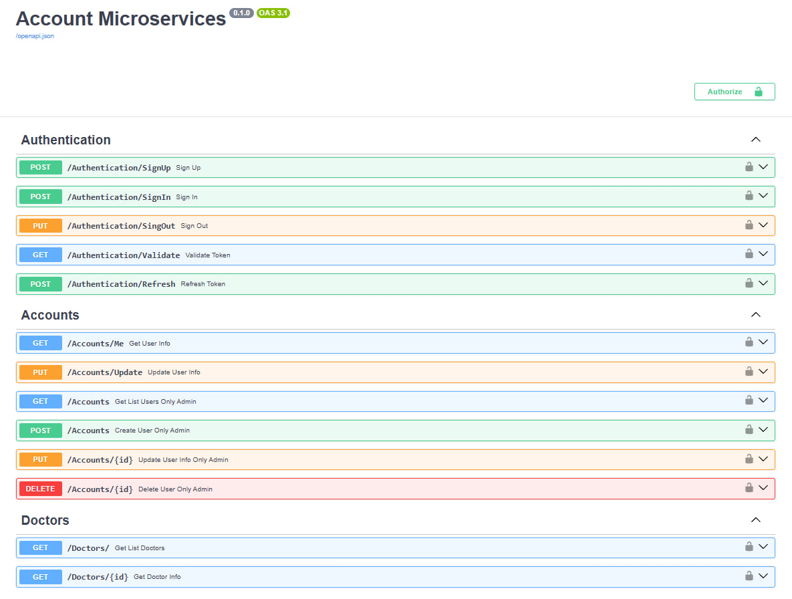
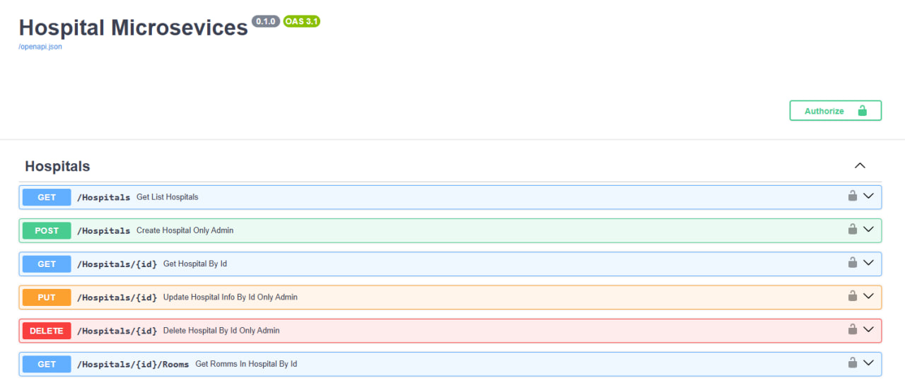
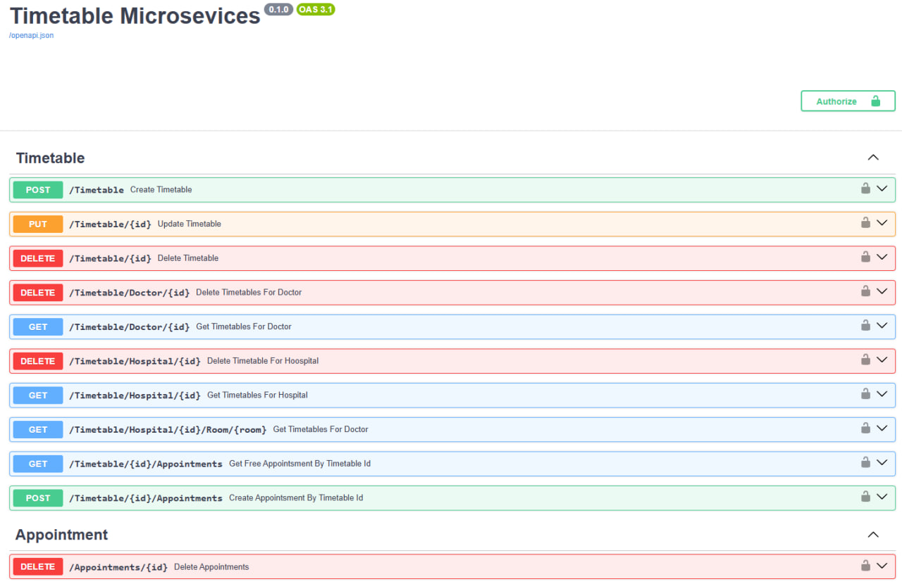
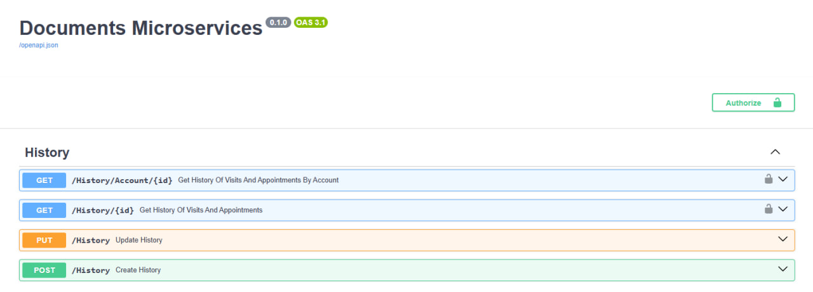
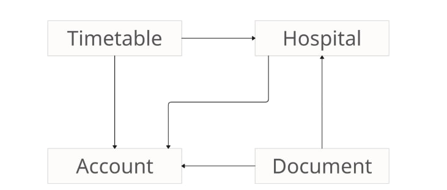
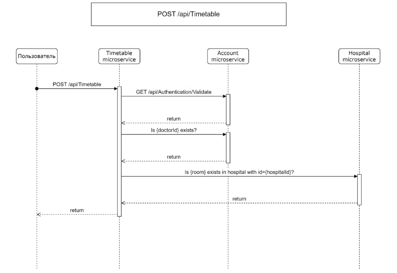

# Medi-Flux — Платформа управления клиническими процессами

Medi-Flux  — это модульная микросервисная платформа для цифровизации клинических процессов, нацеленная на повышение эффективности работы медицинских учреждений и улучшение доступа к медицинским данным.

## Основные возможности
- Микросервисная архитектура с асинхронным взаимодействием через RabbitMQ
- Регистрация пациентов и врачей
- Управление расписанием приёмов
- Ведение медицинских записей и истории посещений
- Интроспекция JWT токенов и контроль доступа
- Расширяемая архитектура: готово к работе с большим числом клиник

## Стек технологий
- Python, FastAPI
- SQLAlchemy, PostgreSQL
- RabbitMQ (aio_pika) для событийной шины
- Docker, docker-compose
- OAuth2 / JWT

## Архитектура
Система построена по микросервисной архитектуре. Каждый сервис отвечает за строго определённую бизнес-область:

### Account microservice
Централизованная авторизация и аутентификация

- Авторизация и аутентификация пользователей
- Генерация и интроспекция JWT токенов
- Хранение базовой информации о пациентах и врачах
- Роли: пациент, врач, администратор


 

### Hospital microservice
Учет больниц, подключённых к системе

- Учет и управление медицинскими учреждениями
- Проверка существования клиники при записи пациентов
- Интеграция с account-service для проверки прав доступа


 

### Timetable microservice
Управление расписанием приёмов

- CRUD расписаний врачей и клиник
- Запись пациентов на приёмы
- Проверка связей между врачами и больницами
- Интеграция с account-service и hospital-service


 

### Document microservice
История посещений и мед. документация

- Хранение записей после приёмов
- Привязка к пациенту, врачу, клинике
- Безопасный доступ к истории через авторизованные запросы


 

## Взаимодействие микросервисов | RabbitMQ используется для:
- Асинхронной коммуникации между сервисами
- Рассылки событий
- Минимизации связности и повышения отказоустойчивости

Каждый сервис подписан на нужные топики/очереди и реагирует на события других сервисов.

## Диаграмма взаимодействия микросервисов
 

## Пример межсервисных запросов в api
 


# Для запуска выполните следующие инструкции
Перед выполнением всех действий проверьте что у вас установлены
- [Docker](https://docs.docker.com/engine/install/)
- [Git](https://git-scm.com/downloads)

Скопируйте репозиторий с помощью команды
```sh
git clone https://github.com/irsCooper/medi-flux.git
```

Теперь откройте терминал в корневой директории проекта и выполните следующую команду
```sh
docker-compose up -d
```

Отлично! Теперь мы можем воспользоваться нашими сервисами. Для этого откройте в браузере следующие ссылки:
- Account service   | http://localhost:8081/ui-swagger
- Hospital service  | http://localhost:8082/ui-swagger
- Timetable service | http://localhost:8083/ui-swagger
- Document service  | http://localhost:8084/ui-swagger